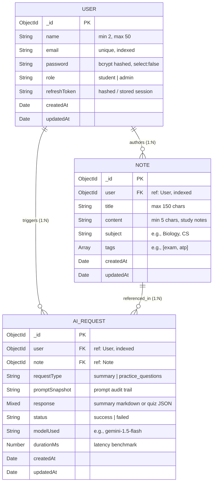

# StudyBuddy Database Schema & ER Diagram

This document details the MongoDB schemas, field validations, relationships, indexes, and aggregation pipelines for **StudyBuddy - AI Study Assistant** (Capstone Topic #10).

---

## 1. Entity Relationship (ER) Diagram



---

## 2. Collections & Validation Specifications

### `User` Collection
* **`name`**: `String`, required, trimmed, min 2, max 50.
* **`email`**: `String`, required, unique index, lowercase, trimmed, validated with regex.
* **`password`**: `String`, required, min 6 characters. Hashed using `bcrypt` pre-save hook (salt rounds = 10). Excluded from default queries via `select: false`.
* **`role`**: `String`, enum: `['student', 'admin']`, defaults to `'student'`.
* **`refreshToken`**: `String`, holds session refresh token, `select: false`.
* **Indexes**:
  * `email` (Unique Single Index)

---

### `Note` Collection
* **`user`**: `ObjectId`, references `User`, required, indexed. Enforces per-user ownership.
* **`title`**: `String`, required, trimmed, max 150 characters.
* **`content`**: `String`, required, trimmed, minimum 5 characters.
* **`subject`**: `String`, defaults to `'General'`.
* **`tags`**: `[String]`, array of keywords.
* **Indexes**:
  * `{ user: 1, createdAt: -1 }` (Compound index for rapid user note queries sorted by newest first)
  * `{ title: 'text', content: 'text', tags: 'text' }` (Full text search index)

---

### `AIRequest` Collection
* **`user`**: `ObjectId`, references `User`, required, indexed.
* **`note`**: `ObjectId`, references `Note`, required.
* **`requestType`**: `String`, enum: `['summary', 'practice_questions', 'key_takeaways']`.
* **`promptSnapshot`**: `String`, snapshot of input sent to AI model.
* **`response`**: `Mixed`, stores either formatted summary text or structured quiz questions array:
  ```json
  [
    {
      "id": 1,
      "question": "What is ...?",
      "options": ["A", "B", "C", "D"],
      "correctIndex": 0,
      "explanation": "..."
    }
  ]
  ```
* **`status`**: `String`, enum: `['success', 'failed']`.
* **`modelUsed`**: `String`, identifier of AI model used.
* **`durationMs`**: `Number`, time taken for generation in milliseconds.
* **Indexes**:
  * `{ user: 1, createdAt: -1 }` (Compound index for student history timeline)
  * `{ createdAt: -1 }` (Index for time-series aggregation)
  * `{ requestType: 1 }` (Index for feature breakdown queries)

---

## 3. Mandatory Aggregation Pipelines

### Aggregation: Requests Per User Per Day
Calculates daily AI quota usage and performance per student:

```javascript
AIRequest.aggregate([
  {
    $group: {
      _id: {
        date: { $dateToString: { format: '%Y-%m-%d', date: '$createdAt' } },
        user: '$user'
      },
      requestCount: { $sum: 1 },
      successfulCount: {
        $sum: { $cond: [{ $eq: ['$status', 'success'] }, 1, 0] }
      },
      failedCount: {
        $sum: { $cond: [{ $eq: ['$status', 'failed'] }, 1, 0] }
      },
      avgDurationMs: { $avg: '$durationMs' }
    }
  },
  {
    $lookup: {
      from: 'users',
      localField: '_id.user',
      foreignField: '_id',
      as: 'user'
    }
  },
  { $unwind: '$user' },
  {
    $project: {
      _id: 0,
      date: '$_id.date',
      userId: '$_id.user',
      userName: '$user.name',
      userEmail: '$user.email',
      requestCount: 1,
      successfulCount: 1,
      failedCount: 1,
      avgDurationMs: { $round: ['$avgDurationMs', 2] }
    }
  },
  { $sort: { date: -1, requestCount: -1 } }
]);
```
